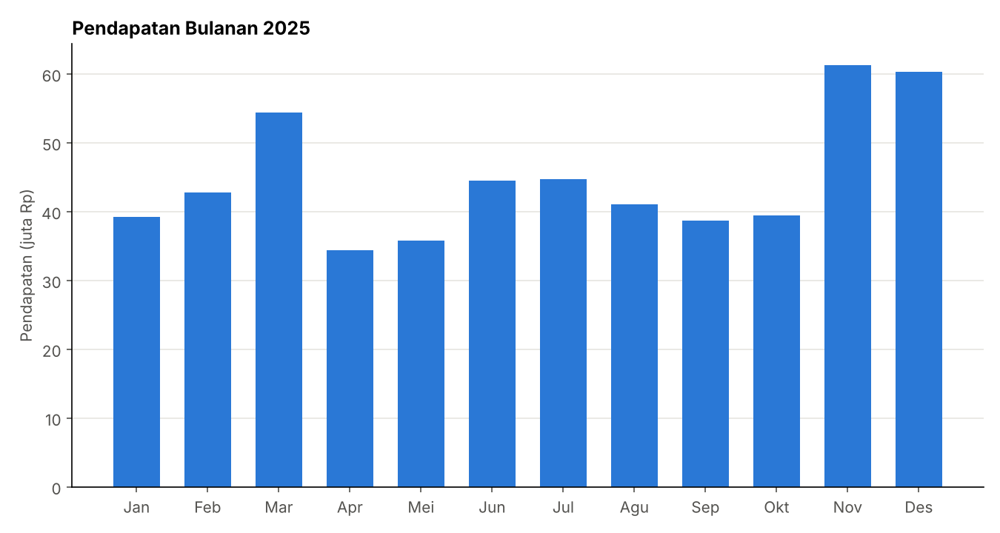
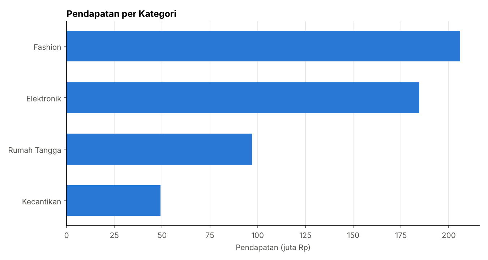
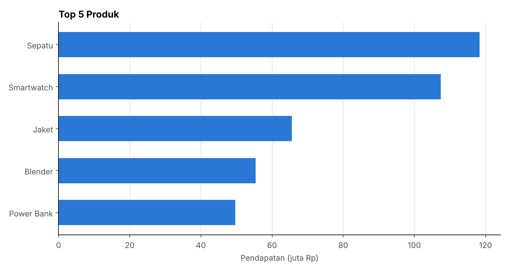
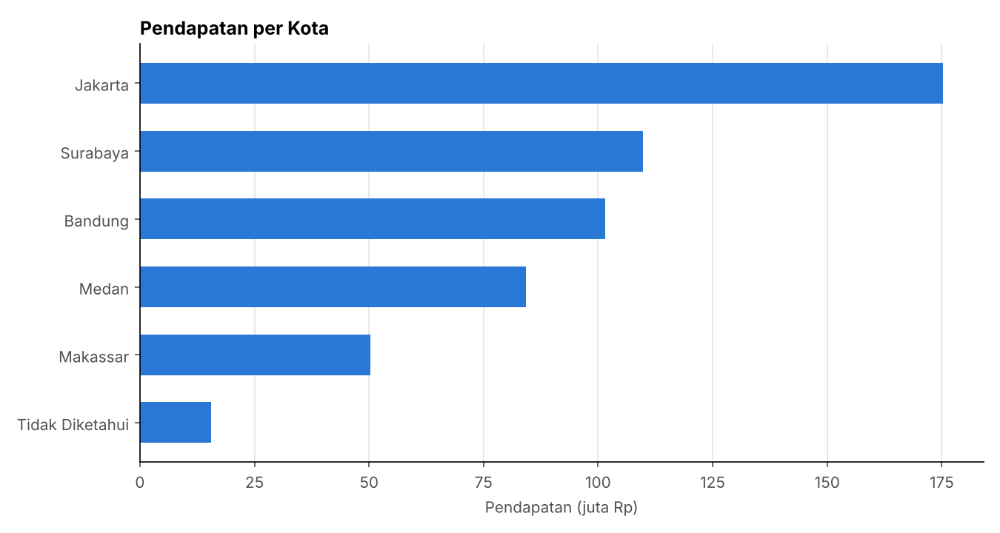

# Level Beginner: Analisis Penjualan TokoKita 2025

> Data **sintetis** untuk latihan. TokoKita adalah toko fiktif.

## 1. Kasus
Kamu baru bergabung sebagai Data Analyst di TokoKita, toko online yang menjual
Elektronik, Fashion, Rumah Tangga, dan Kecantikan di 5 kota. Manajer penjualan
meminta ringkasan performa tahun 2025. Data mentahnya belum rapi.

**Skill:** data cleaning, agregasi, KPI, visualisasi dasar (pandas, SQL, matplotlib).

## 2. Kamus Data (`data/penjualan_tokokita_raw.csv`)
| Kolom | Keterangan |
|---|---|
| order_id | ID pesanan (satu produk per pesanan) |
| tanggal | Tanggal pesanan (YYYY-MM-DD) |
| kota | Kota pembeli |
| kategori | Kategori produk |
| produk | Nama produk |
| jumlah | Unit dibeli |
| harga_satuan | Harga per unit (Rp) |
| diskon_persen | Diskon (%) |
| metode_bayar | Metode pembayaran |

## 3. Pertanyaan
1. Masalah kualitas data apa saja yang ada, dan bagaimana menanganinya?
2. Berapa total pendapatan, jumlah order, unit terjual, dan rata-rata nilai order?
3. Bagaimana tren pendapatan bulanan? Bulan mana tertinggi dan terendah?
4. Kategori mana yang menyumbang pendapatan terbesar?
5. Apa 5 produk dengan pendapatan tertinggi?
6. Bagaimana performa tiap kota?
7. Metode pembayaran apa yang paling sering dipakai?
8. Apa rekomendasi untuk manajer penjualan?

Coba kerjakan sendiri dulu sebelum membaca jawaban.

## 4. Penyelesaian

### Q1. Data cleaning
| Masalah | Temuan | Penanganan |
|---|---|---|
| Baris duplikat | 25 | Dihapus |
| Penulisan kota tidak konsisten (huruf besar/kecil, spasi) | 15 variasi, termasuk 5 nama baku | Trim + Title Case |
| `kota` kosong | 25 | Diisi "Tidak Diketahui" |
| `metode_bayar` kosong | 30 | Diisi "Tidak Diketahui" |
| `jumlah` kosong | 15 | Baris dihapus, pendapatan tidak bisa dihitung |

Hasil: 1.225 baris menjadi **1.185 baris**.
Rumus: `pendapatan = jumlah x harga_satuan x (1 - diskon_persen/100)`

### Q2. KPI utama
| KPI | Nilai |
|---|---|
| Total pendapatan | Rp536.737.000 |
| Jumlah order | 1.185 |
| Unit terjual | 2.332 |
| Rata-rata nilai order | Rp452.943 |

### Q3. Tren bulanan


Tertinggi **November (Rp61,3 juta)**, disusul Desember (Rp60,3 juta) dan Maret
(Rp54,5 juta). Terendah **April (Rp34,4 juta)**. November dan Desember menyumbang
22,7% pendapatan setahun.

### Q4. Kategori


**Fashion 38,4%**, Elektronik 34,4%, Rumah Tangga 18,1%, Kecantikan 9,2%.
Fashion dan Elektronik bersama menyumbang 72,8%.

### Q5. Top 5 produk


Sepatu (Rp118,3 juta), Smartwatch (Rp107,4 juta), Jaket (Rp65,6 juta),
Blender (Rp55,4 juta), Power Bank (Rp49,7 juta). Sepatu dan Smartwatch saja
menyumbang 42,0%.

### Q6. Kota


| Kota | Order | Pendapatan | Rata-rata/order |
|---|---|---|---|
| Jakarta | 378 | Rp175,3 juta | Rp463.772 |
| Surabaya | 255 | Rp109,8 juta | Rp430.417 |
| Bandung | 231 | Rp101,6 juta | Rp439.716 |
| Medan | 171 | Rp84,2 juta | Rp492.512 |
| Makassar | 125 | Rp50,4 juta | Rp403.026 |
| Tidak Diketahui | 25 | Rp15,5 juta | Rp620.100 |

Jakarta terbesar (32,7%). Di antara kota yang diketahui, rata-rata nilai order
tertinggi ada di Medan.

### Q7. Metode pembayaran
E-Wallet 37,2%, Transfer Bank 31,1%, COD 18,9%, Kartu Kredit 10,3%,
Tidak Diketahui 2,5%.

### Q8. Rekomendasi
1. Siapkan stok dan promosi sebelum November-Desember, terutama Sepatu dan Smartwatch.
2. Uji promosi pada April-Mei, saat pendapatan rendah.
3. Uji bundling di Kecantikan (mis. Serum + Sunscreen) untuk menaikkan nilai order.
4. Uji penawaran upsell di Makassar, yang rata-rata nilai ordernya terendah, lalu ukur dampaknya.
5. Jadikan kota dan metode bayar kolom wajib di sistem pemesanan.

### Keterbatasan
- Data sintetis, jadi insight hanya untuk latihan.
- Hanya satu tahun data, pola musiman belum bisa dipastikan.
- Tidak ada data biaya, sehingga profit tidak bisa dihitung.
- Setiap baris dianggap pesanan yang selesai (tidak ada data retur/batal).

## 5. Cara Menjalankan
Dari folder utama proyek:
```bash
pip install -r requirements.txt
python 01-beginner/src/analisis.py
python 01-beginner/sql/run_sql.py
```
Atau buka `01-beginner/notebooks/analisis.ipynb` di Jupyter / VS Code / Google Colab
(untuk Colab, unggah juga folder `data/` dan sesuaikan `BASE`).
