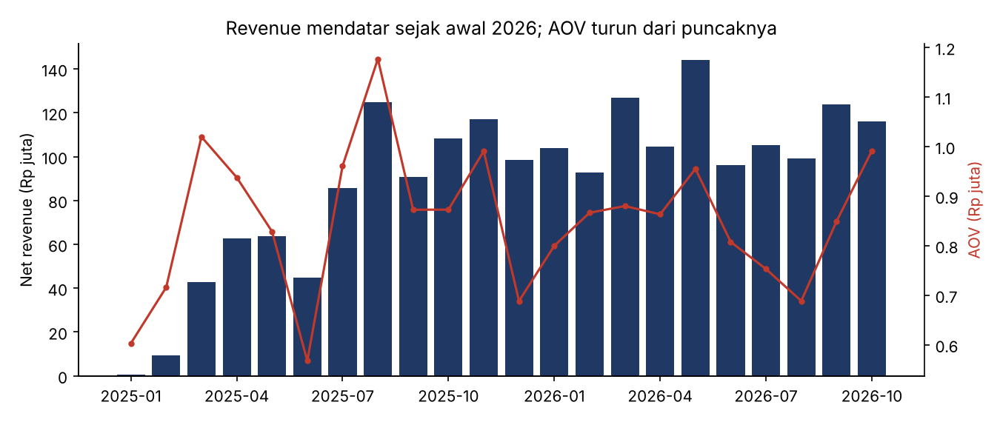
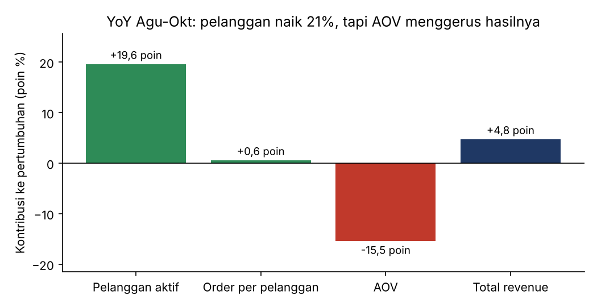
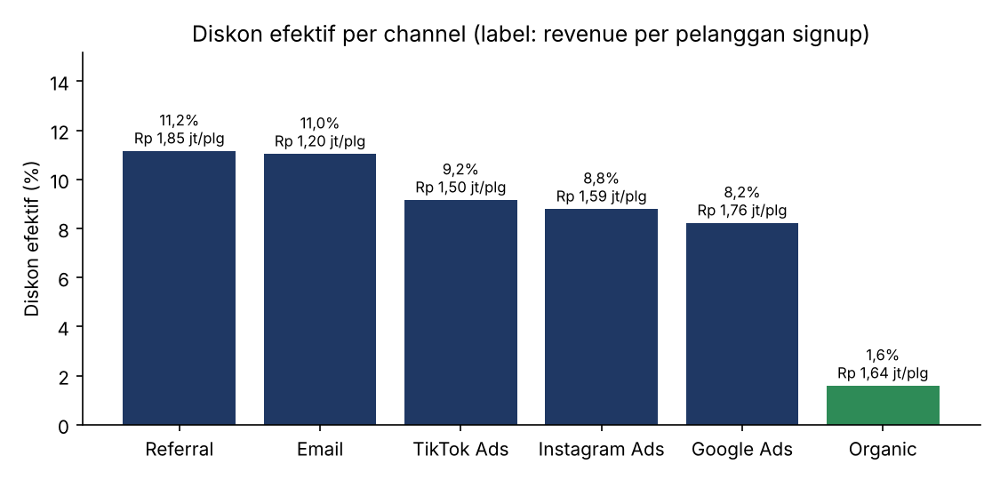
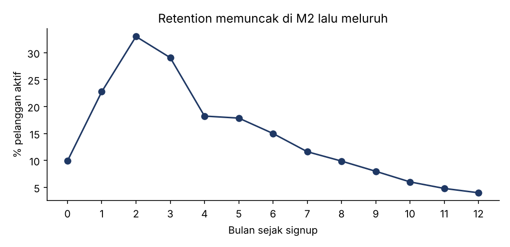
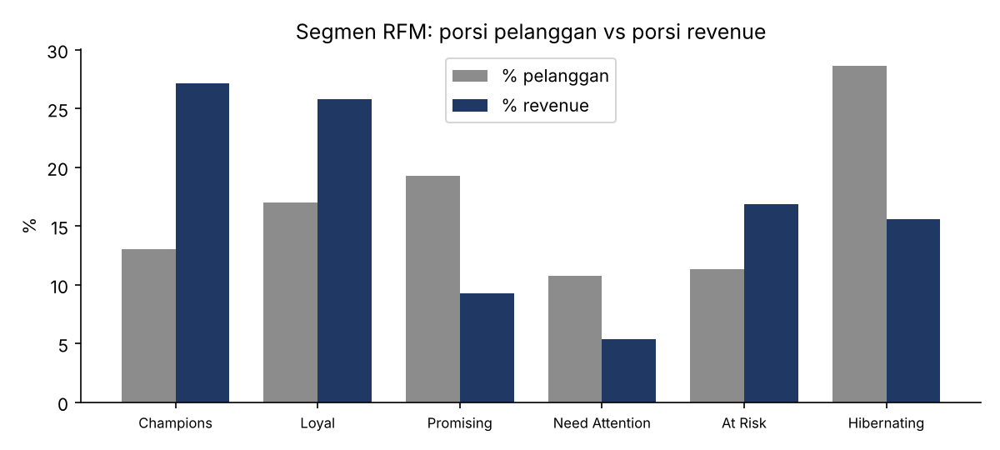

# Tugas 11 - Ringkasan untuk direksi: kenapa revenue TokoNusa melambat?

> Basis angka: order Completed berharga, net revenue = unit_price x qty x (1 - diskon). Periode "3 bulan terakhir" = Agu-Okt 2026. Detail & rekonsiliasi: `level2_deskriptif/` dan `level3_diagnosis/`.

## Slide 1 - Kesimpulan
**Revenue praktis datar walau basis pelanggan naik.** Agu-Okt 2026 = Rp 339 jt: **+4,8% vs tahun lalu** dan **-1,9% vs Mei-Jul 2026**. Pelanggan aktif naik 21% YoY, tetapi nilai per order (AOV) turun 14% karena **order bergeser dari Elektronik** (bukan karena diskon atau frekuensi order).
Tiga langkah: (1) rasionalisasi diskon channel berbayar, (2) pulihkan mix Elektronik, (3) reaktivasi pelanggan yang mulai tidak aktif.

## Slide 2 - Apa yang terjadi

- Kenaikan 2025 sebagian besar efek basis pelanggan yang dibangun dari nol; sejak 2026 revenue bergerak di kisaran Rp 92-144 jt/bulan.
- Agu-Okt 2026: Rp 339 jt; Mei-Jul 2026: Rp 346 jt; Agu-Okt 2025: Rp 324 jt.

## Slide 3 - Kenapa: AOV, bukan jumlah pelanggan atau frekuensi

- Pelanggan aktif 227 -> 275 menambah **19,6 poin** pertumbuhan; order per pelanggan nyaris tidak berubah (0,6 poin); **AOV menggerus 15,5 poin**.
- **86% penurunan AOV adalah efek mix:** share order Elektronik turun dari 25,4% ke 19,4%. AOV Elektronik Rp 2,4 jt vs Rp 0,5 jt untuk kategori lain (gabungan), dan Elektronik = 56% revenue total.
- **Bukan diskon:** diskon efektif justru turun dari 8,2% ke 6,5%.

## Slide 4 - Pelanggan & channel

- Channel berbayar (Ads), Referral, dan Email memberi diskon efektif 8,2%-11,2%; **Organic hanya 1,6%**. Revenue per pelanggan antar channel **tidak berbeda signifikan** (Kruskal-Wallis p=0,30): pelanggan berbayar tidak lebih bernilai, tetapi lebih "disubsidi".

- Pelanggan aktif memuncak 33% di bulan ke-2 setelah signup lalu meluruh (M6 15%, M12 4%): sebagian besar pelanggan berhenti setelah beberapa order.

- 20% pelanggan teratas = 57,3% revenue. Segmen **At Risk** = 11% pelanggan dan 17% revenue historis.

## Slide 5 - Rekomendasi
| # | Rekomendasi | Dasar | Estimasi dampak (ilustratif) |
|---|---|---|---|
| 1 | **Rasionalisasi diskon channel berbayar/Referral/Email**: uji pemotongan sepertiga kedalaman diskon | Diskon ~8,7% vs Organic 1,6% tanpa revenue/pelanggan lebih tinggi | Diskon 12 bulan terakhir di channel ini Rp 95 jt; memotong sepertiganya menghemat sampai ~Rp 32 jt (batas atas, jika volume order tidak turun). **Impas bila order turun < 3,1%** |
| 2 | **Pulihkan mix Elektronik**: bundling/cross-sell Elektronik, prioritas stok & iklan produk Elektronik | Share Elektronik turun 6,0 poin; satu order Elektronik ~ 5,1x order lain | Bila share kembali ke level Agu-Okt 2025: ~25 order/kuartal bergeser ke Elektronik = **~Rp 47 jt per kuartal** (sensitivitas, bukan prakiraan) |
| 3 | **Reaktivasi dini** pelanggan yang 60-150 hari tidak order (voucher ongkir + pengingat) | Retention meluruh setelah M2-M3; baseline reorder 60 hari di segmen ini 17,8% | Lift +8 poin pada ~144 pelanggan/bulan = ~12 order tambahan/bulan = ~Rp 10 jt/bulan (~9% dari revenue bulanan), dikurangi biaya voucher. **Diuji dulu lewat A/B (tugas 12)** |

**Perlu diverifikasi:** (a) data signup berhenti 24 Agu 2026 - tidak ada pelanggan baru Sep-Okt 2026; konfirmasi apakah akuisisi benar-benar berhenti atau data belum lengkap. (b) Biaya iklan tidak ada di data, jadi klaim "budget naik 30%" tidak dapat dihubungkan ke hasil; butuh CAC/ROAS per channel. (c) 25 baris quantity negatif diasumsikan salah input; pengaruhnya kecil (20 baris Completed).

## Keterbatasan
Data sintetis/sampel ~2.700 order sehingga selisih kecil antar kelompok (cancel/return, channel) tidak signifikan dan tidak dijadikan dasar rekomendasi. Estimasi dampak adalah sensitivitas dengan asumsi eksplisit, bukan prakiraan.
